<div align="center">
  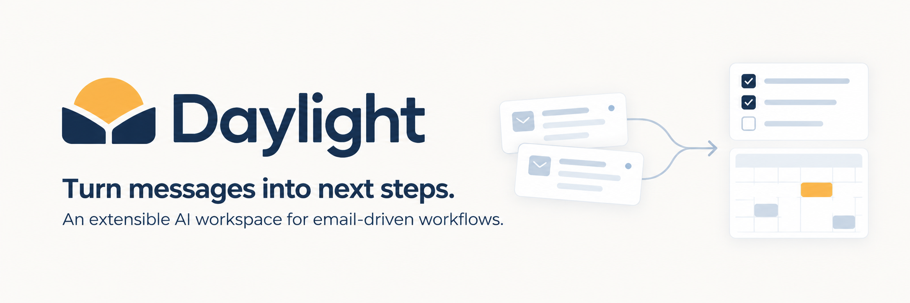
  <p><strong>让分散的信息，成为可追踪的下一步。</strong></p>
  <p>邮件驱动的多场景 Agent 工作台 · UCloud 优刻得 AI 黑客松 · Track B / AI Application</p>
  <p><strong>简体中文 · <a href="README_EN.md">English</a></strong></p>
  <p>
    
    =22" />
    
    
    
  </p>
  <p><a href="#overview">项目介绍</a> · <a href="#screenshots">界面展示</a> · <a href="#architecture">系统架构</a> · <a href="#quickstart">快速开始</a> · <a href="#deploy">部署</a> · <a href="#usage">开始使用</a> · <a href="docs/README.md">文档</a> · <a href="#contributing">参与贡献</a></p>
</div>

<details>
<summary><strong>目录</strong></summary>

[项目介绍](#overview) · [快速开始](#quickstart) · [多邮箱](#mailboxes) · [招聘与发票](#workflows) · [页面截图](#screenshots) · [架构](#architecture) · [完整部署](#deploy) · [运维排障](#operations) · [开始使用](#usage) · [模板扩展](#templates) · [开发](#development) · [验证与比赛材料](#evidence) · [路线图](#roadmap) · [参与贡献](#contributing)

</details>

---

<a id="overview"></a>
## ☀️ 项目介绍

**Daylight 是一个可以自己部署、按场景定制的邮件管理 Agent 工作台。** 它将邮箱、附件、日历和待办放在一起，帮助用户找回通知、整理材料、跟进进度、准备回复。

项目从上海科技大学的日常邮件使用出发：讲座报名、竞赛截止、材料补交、导师联系和面试改期，常常同时出现在收件箱里。通知容易漏，过几天想找某个要求又要翻很久。招聘和发票也有类似的问题——候选人与往来邮件需要串起来，票据与字段需要反复核对。**打开过邮件，并不代表事情已经办完。**

Daylight 围绕这些事情提供两层功能：日常使用的邮箱、检索、日历与待办；以及按不同流程组织材料和进度的场景工作台。当前重点展示智能招聘、发票助手、科大学习站和邮件收发，保研、申博、求职、投稿等模板用于扩展其他邮件事务。邮件菜单和邮件收发里的正文按原有 HTML 版式显示，图片、表格和样式会一起呈现。

| 常见做法 | Daylight 的处理方式 |
| --- | --- |
| 标星后还要记得回来看 | 把通知关联到事项，分开记录待办、阶段和材料 |
| 在邮箱里反复搜关键词 | 用自然语言查找已入库邮件和附件，点击回答返回原文 |
| 校园、个人、工作邮箱来回切换 | 按邮箱分类，可只看一个、同类混合或全部混合 |
| 改期后手工重写日历 | 保留原安排和变更来源，关联新旧日程 |
| 简历与发票附件分散 | 在招聘、发票页面集中查看，处理结果可对照原件 |

**当前交付：** Web 工作区、预置模板、知识检索、小 D 助手，以及 API / Worker / Scheduler 分离的 Compose 部署。已有单节点云端运行和部分真实服务验证记录；多服务器高可用、长期容量与真实用户收益仍需分别测量。这里不引用尚未完成回收的问卷比例，也不承诺未经测量的效率提升。详见 [STATUS](STATUS.md)。

<a id="quickstart"></a>
## ⚡ 快速开始

安装好 **Docker、Compose v2、Git、openssl、curl** 后，在 Linux、macOS 终端或 Windows WSL 中执行：

```bash
git clone --branch feat/cloud-native-platform https://github.com/why121368/Daylight.git
cd Daylight
sh deploy/up.sh
```

访问地址：**[http://localhost:3000](http://localhost:3000)**

脚本自动生成配置和随机服务密码，构建镜像、初始化数据库与私有桶，并检查应用健康状态。宿主机无需单独安装 Node.js 或数据库。当前部署说明对应 `feat/cloud-native-platform` 分支；发布 Tag 确定后请优先使用对应版本。

**首次使用还需三步：** [创建管理员](#admin-setup) → [配置系统 SMTP（供普通用户注册）](#system-mail) → [连接工作邮箱与模型](#usage)。平台启动不会自动连接私人邮箱或购买模型服务。

- 需要完整操作和配置：[一键部署](#deploy)
- 已有环境，查运维和问题：[更新与排障](#operations)
- 需要改代码：[本地开发](#development)
- 需要查看实现范围与比赛材料：[验证与交付](#evidence)

### 六类预置工作台

| 场景 | 管理对象与关键流程 | 业务边界 |
| --- | --- | --- |
| **智能招聘** | 候选人、简历 PDF/OCR、筛选、知识检索、面试邀约及沟通 | 实际发信审核确认；飞书需另行配置与授权 |
| **发票助手** | 附件票据、字段核对、原件回查与报销准备 | 提取结果对照原件核验，不据此自动改日程/待办 |
| **保研申请** | 夏令营、预推免、导师联系；多校机会、材料、限时确认、面试及改期 | 优秀营员、欢迎报考不等于正式录取；外部报名需回执 |
| **申博 / 海外研究 / RA** | 联系人上下文、研究计划版本、跨时区面谈、后续跟进 | 礼貌回复不代表名额承诺；保留原时区、UTC 与北京时间 |
| **校招求职** | 公司与岗位、测评笔试、材料补交、面试和投递进度 | 补材料不自动晋级；平台/短信/微信信息需补充 |
| **科研投稿与参会** | 修订、共同作者前置行动、终稿、注册缴费与报告安排 | 投稿与缴费状态需要外部证据 |

一个账号可添加多个工作台，不按普通用户或 HR 类型限制功能。模板中心当前将招聘、发票列为官方入口，其余预置模板位于社区分类；该分类不表示已有开放的第三方社区发布市场。

### 平台能力

| 模块 | 主要功能 | 使用说明 |
| --- | --- | --- |
| **智能招聘** | 候选人、简历 PDF/OCR、筛选与面试邀约 | 引用简历原文；审核后发送；飞书可选 |
| **发票助手** | 号码、购销方、金额、税额与明细提取 | 对照原件核对，保留附件查看入口 |
| **多邮箱** | 常用邮箱与自定义 IMAP/SMTP、分类与混合查看 | 账号/邮箱隔离，支持来源关联及外部通知 |
| **日历待办** | 月/周/日视图、截止、优先级、冲突与改期 | 保留来源；按工作台筛选并核验完成状态 |
| **事项材料** | 业务阶段、建议、材料版本与前置行动 | 保留历史，关键阶段需要回执 |
| **小 D 助手** | 查邮件、做简报、管理日程待办、起草回复 | 支持语音输入、会议辅助与发送审核 |
| **知识检索** | 邮件/附件/简历分块、混合检索与原文高亮 | RRF 融合、MMR 去冗余、Embedding 限流重试 |
| **模板定制** | 字段、阶段、规则、材料、页面块与能力配置 | JSON 导入导出、升级、显隐与删除 |
| **后台任务** | 状态、取消、重试、检查点与邮箱顺序 | 有限重试预算、租约与旧执行者保护 |
| **日志费用** | 工具调用、错误、耗时、Token 与费用 | 按调用时价格统计，显示已知费用及覆盖率 |
| **账号管理** | 认证、会话、管理员、配置与全局搜索 | 系统发信与用户邮箱发信分开 |
| **更多协作** | 外部日历、私密 ICS、活动材料与复盘报告 | 独立 iOS 工程复用共享 API |

<a id="mailboxes"></a>
## 📬 多邮箱，分开看，也能一起找

为校园、生活和工作邮箱设置分类。日历与待办按当前范围展示；邮件页问答和小 D 的知识检索也使用所选范围，从已入库内容中找回通知。

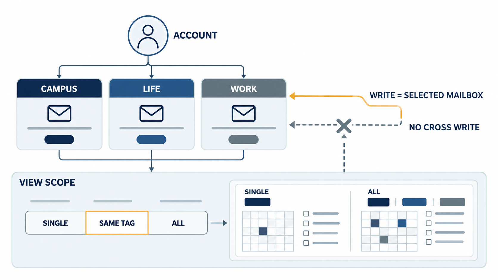

| 视图 | 适合什么情况 | 检索范围 |
| --- | --- | --- |
| **单邮箱** | 只处理当前收件箱 | 当前自有邮箱的已入库内容 |
| **同类混合** | 一起看校园或工作分类 | 同标签下自有邮箱的已入库内容 |
| **全部混合** | 找不清在哪个邮箱的通知、统筹安排 | 当前用户全部自有邮箱的已入库内容 |

混合查看不会赋予访问他人邮箱的权限，也不会把写操作广播到全部邮箱。普通建日程、草稿和发送仍使用当前选中的邮箱；工作台使用其绑定邮箱，并按业务接口检查归属。检索只能找回已建立索引的内容，不能保证历史邮箱全部覆盖。

<a id="workflows"></a>
## 🧑‍💼 招聘与发票：两条主要使用流程

### 招聘：从简历到面试沟通

收到求职邮件 → 保存附件 → 提取 PDF 文字或 OCR → 整理候选人资料 → 对话筛选 → 准备邀约 → 人工审核发送。

在人才库查看资料、简历与来源，提问时可以返回对应页码和原文。扫描件、识别失败与信息不全需回查或重试；飞书建会是可选能力，需自行配置。既有招聘数据直接复用，不因添加工作台复制一份。

<details>
<summary>查看招聘处理流程图</summary>

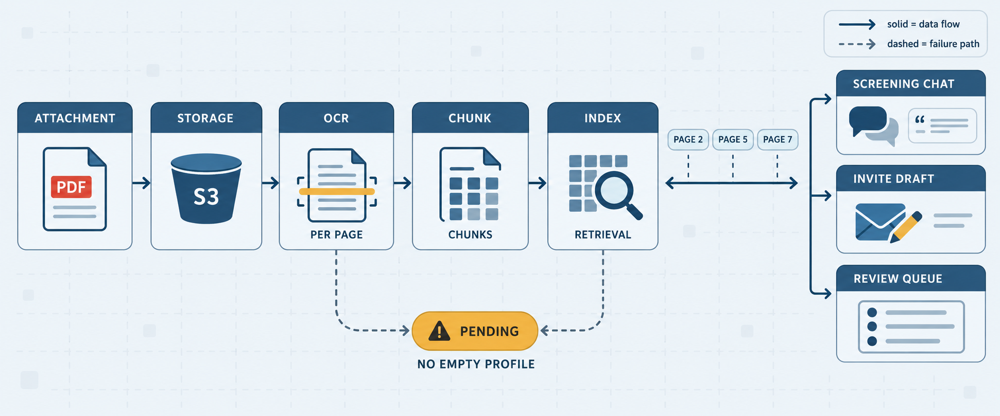

</details>

### 发票：从邮件附件到字段核对

发现票据附件 → 提取号码、日期、购销方、金额/税额和明细 → 对照原票 → 整理报销材料。

发票页保留原附件查看/下载入口；提取结果需要核对，不代表税务验真、已经报销或完成付款。识别发票本身不会自动生成日程与待办。

<details>
<summary>查看发票处理流程图</summary>

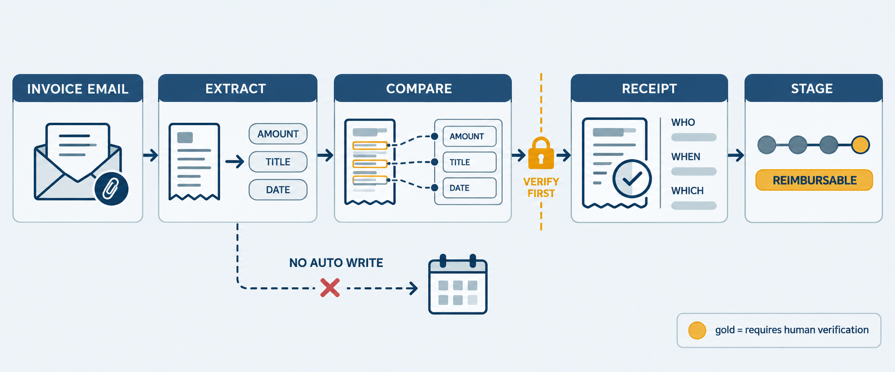

</details>

<a id="screenshots"></a>
## 🖼️ 界面与演示

以下为**截图占位**，按核心用户流程预留；替换要求与建议镜头见 [截图拍摄清单](docs/assets/readme/README.md)。架构等说明图已使用项目现有素材，说明图不作为实机截图。

<table>
  <tr>
    <td width="50%" align="center">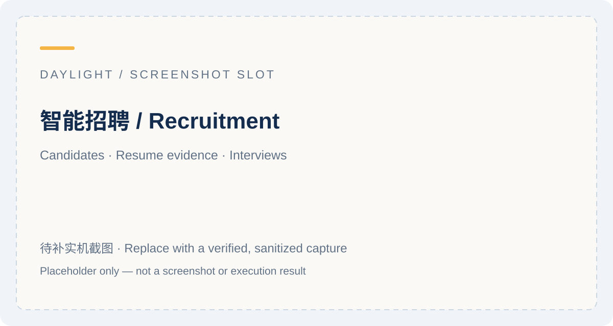<br /><b>01 · 智能招聘：候选人与邀约</b></td>
    <td width="50%" align="center">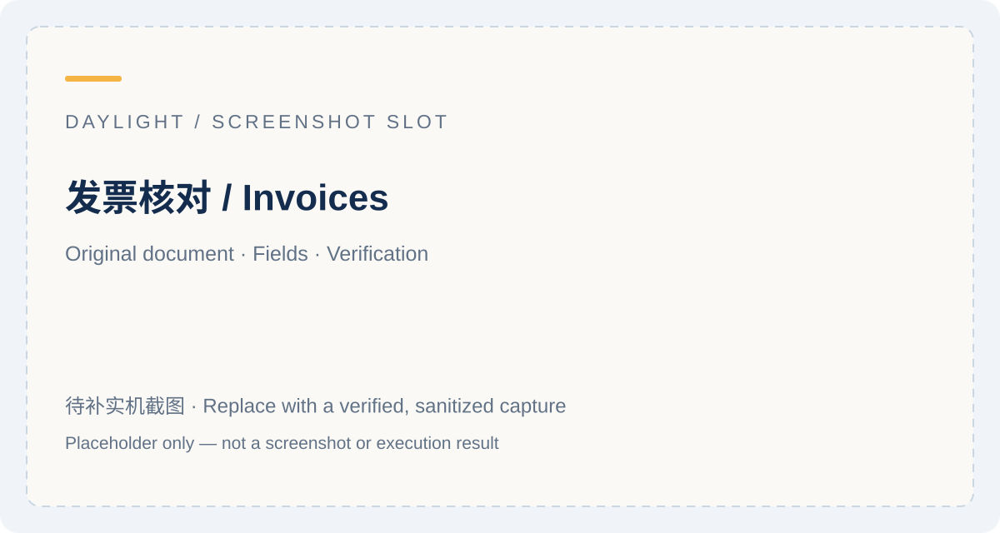<br /><b>02 · 发票助手：原件与核对</b></td>
  </tr>
  <tr>
    <td width="50%" align="center">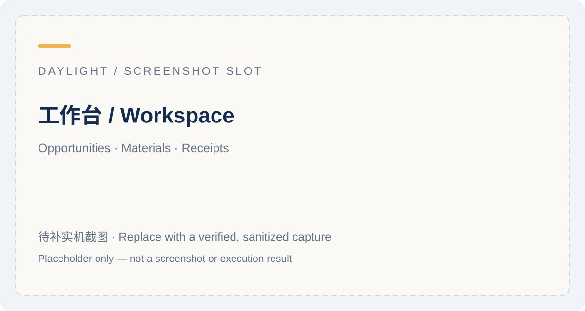<br /><b>03 · 工作台：事项、材料与回执</b></td>
    <td width="50%" align="center">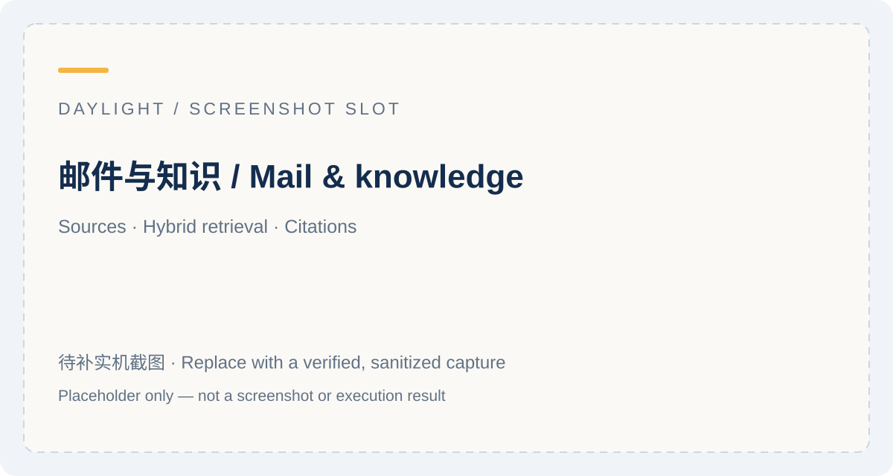<br /><b>04 · 邮件：查找与原文</b></td>
  </tr>
  <tr>
    <td width="50%" align="center">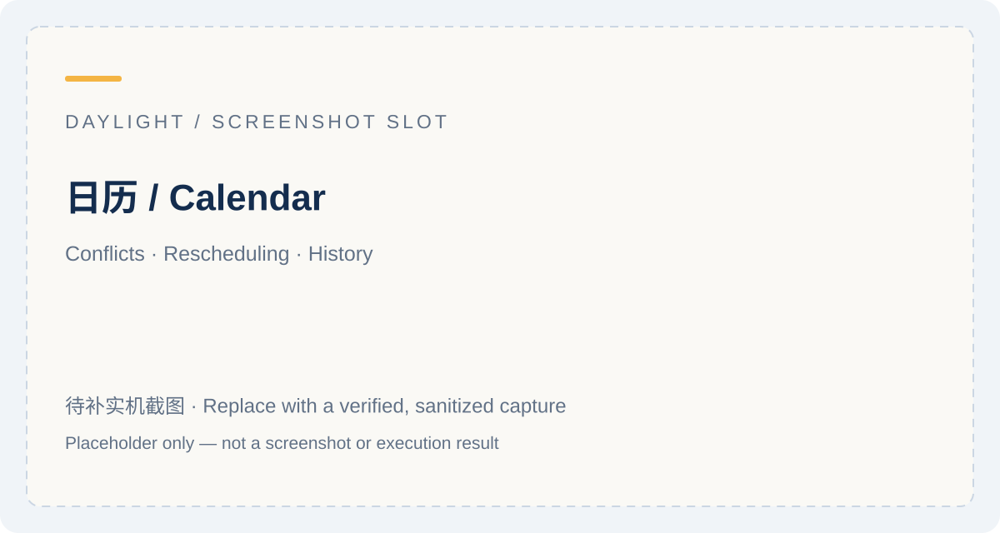<br /><b>05 · 日历：冲突与改期</b></td>
    <td width="50%" align="center">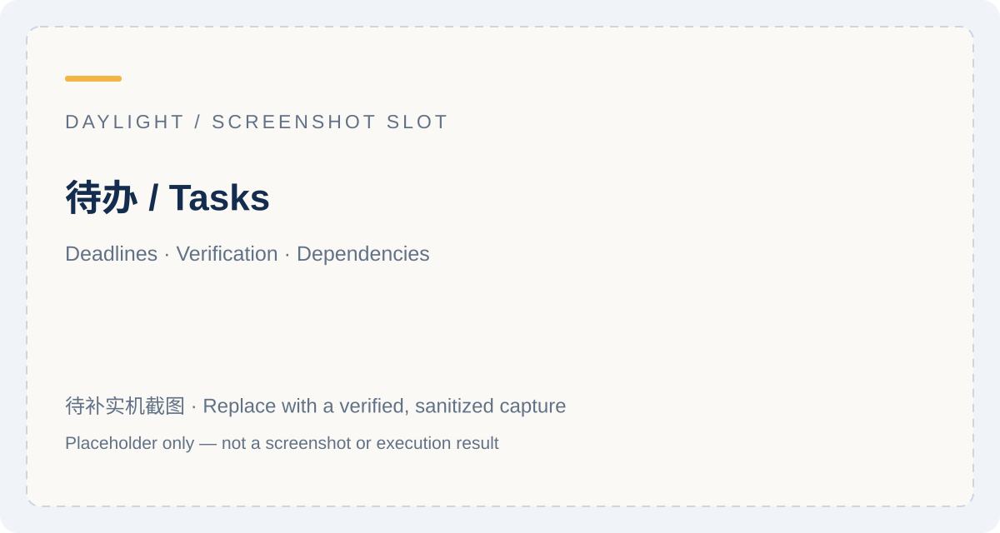<br /><b>06 · 待办：期限与完成</b></td>
  </tr>
  <tr>
    <td width="50%" align="center">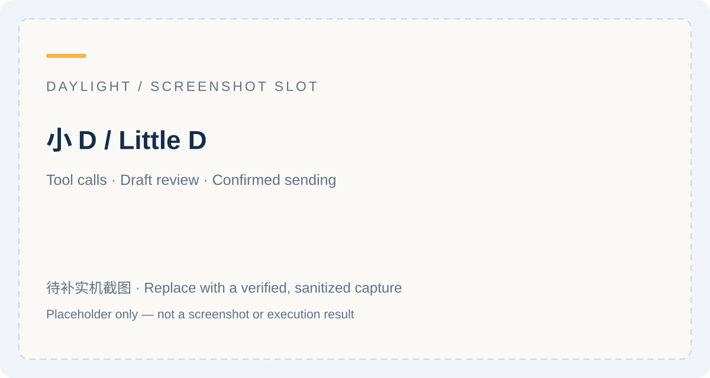<br /><b>07 · 小 D：工具与审核</b></td>
    <td width="50%" align="center">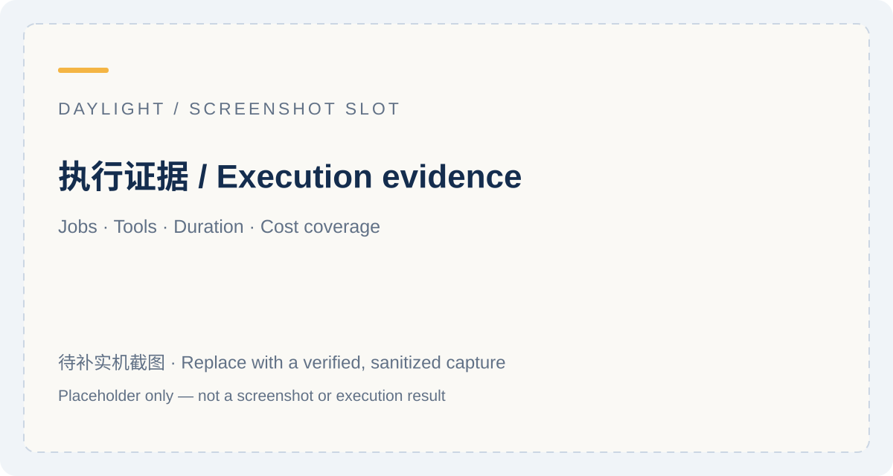<br /><b>08 · 执行记录：任务与费用</b></td>
  </tr>
</table>

**推荐演示：** 招聘邮件 → 简历与候选人 → 检索原文 → 准备并审核邀约；接着展示发票字段与原件对照。校园通知与多邮箱分类用于介绍问题来源，保研等模板说明扩展方式。现场以实际运行为主，录屏用于备用；准备入口见 [演示脚本](docs/submission/defense.md) 和 [提交清单](docs/submission/README.md)。账号获取和在线地址按最终发布信息提供，不公开私人邮箱密码。

<a id="architecture"></a>
## 🏗️ 系统架构

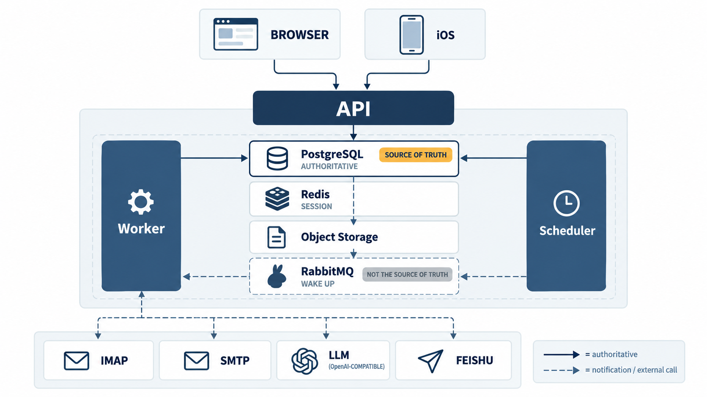

| 组件 | 职责 | 主要技术与状态 |
| --- | --- | --- |
| **Web** | 工作台、邮箱、日历、待办、审核与执行记录 | React 19、Vite 7、Tailwind CSS 4、shadcn/Radix、FullCalendar |
| **API** | 鉴权、邮箱归属、用户交互、业务提交、后台任务回执 | Node.js 22+、Express；生产模式使用共享状态 |
| **Worker** | 执行邮箱同步、事项分析、外部日历任务 | 持久任务 claim、心跳、检查点、有限重试 |
| **Scheduler** | 定时同步、任务调度与恢复协作 | 检查邮箱运行中任务和失败退避，避免重复积压 |
| **PostgreSQL** | 业务快照、任务、步骤、outbox 等权威状态 | 事务、版本/CAS、租约与提交校验 |
| **Redis** | 验证码、会话辅助及共享临时状态 | 生产依赖明确失败，不静默替换为进程内状态 |
| **RabbitMQ** | 发布确认与任务唤醒通知 | 任务权威在 PG；通知可重复，数据库轮询承担恢复路径 |
| **对象存储** | 附件与文件 | Compose 自带私有 MinIO；可配置 US3、S3 兼容及其他已有提供商 |
| **外部服务** | 收信、回信、模型、日历和会议 | IMAP/SMTP、OpenAI 兼容 Chat Completions、Embedding、可选飞书等 |

### 部署拓扑与一致性

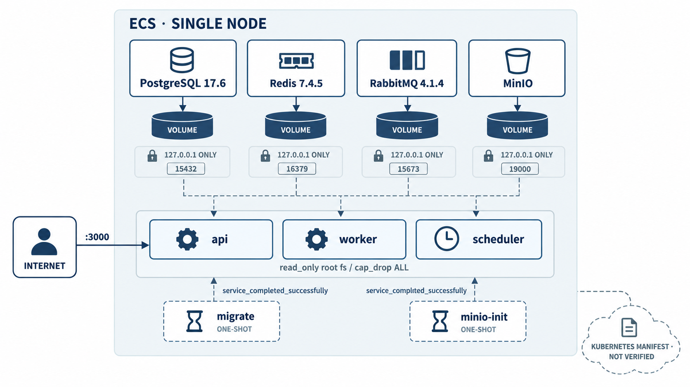

当前 Compose 包含 **7 个常驻服务 + 2 个一次性初始化任务**。图中公网 `:3000` 为可配置的发布方式，**实际默认仅绑定 `127.0.0.1:3000`**；依赖端口也仅映射回环。生产配置通过环境变量注入，首次启动显式迁移和创建私有桶，应用等待初始化成功后启动。开发模式可使用 JSON/本地文件；生产模式不会把静默文件回退作为故障恢复。

任务与 outbox 同事务入库；Worker 根据 PG claim 执行，同邮箱有序、不同邮箱可并行。数据库步骤可用检查点恢复；SMTP 等远端副作用不能随数据库事务回滚，结果未知时保留 `unknown` 并人工核查，不能盲目重发。扩缩容取决于邮箱并行度、数据库及模型配额；KEDA 示例尚不能视为已验收自动伸缩。

**启动期依赖抖动不再让进程直接退出（代码已实现 + 本地测试通过；云端复验未做）**：生产模式下启动连不上 PostgreSQL/Redis 时按退避重试（默认总窗口 60s、500ms 起、上限 8s），只重试连接类错误，配置或 schema 错误立刻失败；窗口用尽后**明确报错退出**（不进入"半边可用"，也不无限重试）。可用 `DAYLIGHT_BOOT_DEP_TIMEOUT_MS`、`DAYLIGHT_BOOT_DEP_BACKOFF_MS`、`DAYLIGHT_BOOT_DEP_MAX_BACKOFF_MS` 调整。起因是云端故障实测：删 PG 主库 Pod 后 9 个 api 副本全部 `exitCode=1` 退出，依赖层其实完成了自动提升，是应用侧把秒级抖动放大成整体不可用（证据 `work/cloud-perf/results-k8s/FINDING-app-boot-crash.md`）。

更多设计见 [代码架构](docs/submission/architecture.md)、[可靠性矩阵](docs/submission/reliability/README.md)、[云原生路线](docs/cloud-native-roadmap.md)。独立 iOS 客户端不在本仓库构建；共享认证、邮箱与日历 API，并提供受控原生 CORS 与私密 ICS 订阅。

### Agent 控制流

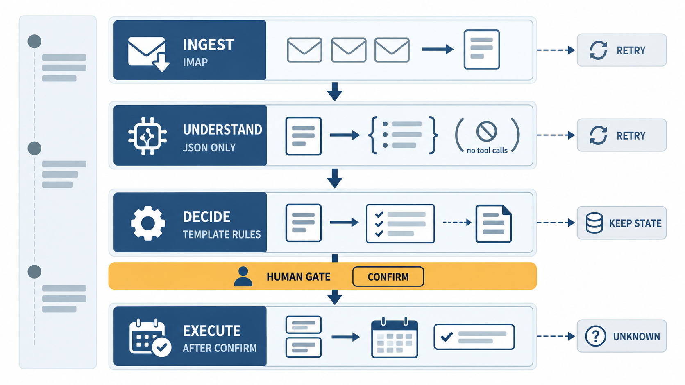

1. **读取与归属**：用户邮箱权限内读取邮件/附件，或登记外部来源，关联到事项。
2. **理解与建议**：模板规则和模型结合上下文，形成阶段、材料、截止待办、安排和草稿建议。
3. **核验与执行**：检查对象、时间、冲突和前置回执；用户确认后提交工作台动作。
4. **追踪与恢复**：保存来源、状态、工具结果和费用，处理后续通知、错误与重试。

邮件内容作为数据处理。已读、已准备、已发送、已提交、对方确认分别管理。工作台建议确认后写入，基础邮件同步可按提取结果直接创建日程/待办；实际发信经过独立审核。模型无效输出、工具错误和歧义需在界面与记录中体现。

<a id="deploy"></a>
## 🚀 一键部署：Docker Compose（推荐）

### 1. 准备环境

| 依赖 | 要求 |
| --- | --- |
| 系统 | Linux；macOS Docker Desktop；Windows 使用 Docker Desktop + WSL2，在 WSL Bash 中执行命令 |
| 工具 | Git、Docker Engine / Docker Desktop、Compose v2 插件、`sh`、`openssl`、`curl` |
| 资源 | 云端已有 4 vCPU / 约 8 GiB 单节点验证记录，可作为试运行参考；这是验证规格，不是最低配置或容量承诺 |
| 网络 | 能访问所需镜像仓库、npm 和系统包源；实际业务还需访问邮箱/模型服务，扫描 OCR 首次可能下载语言包 |

Docker 路径不要求宿主安装 Node.js、PostgreSQL、Redis 或 RabbitMQ。先启动 Docker，再确认：

```bash
docker info
docker compose version
openssl version
curl --version
```

### 2. 获取项目并启动

```bash
git clone --branch feat/cloud-native-platform https://github.com/why121368/Daylight.git
cd Daylight
sh deploy/up.sh
```

如果已安装 Node.js，也可以使用等价命令 `npm run deploy:up`。脚本会：

- 首次生成 `deploy/compose.env`，用独立随机密码和 JWT secret，文件权限设为 `600`；已有文件直接复用。
- 校验 Compose 配置，构建前端与运行镜像，启动 PG、Redis、RabbitMQ、MinIO。
- 执行 `migrate` 和 `minio-init`，再启动 API、Worker、Scheduler。
- 等待服务健康，并检查 `/health/live`、`/health/ready`，成功后输出访问入口。

预期访问 **[http://localhost:3000](http://localhost:3000)**。`migrate`、`minio-init` 显示 **Exited (0)** 属于正常完成；其余 7 个服务应为 healthy。一键部署完成基础环境，账号、邮箱和模型按下节初始化。

<details>
<summary>查看启动顺序说明图</summary>

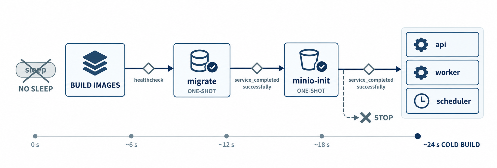

</details>

<a id="admin-setup"></a>
### 3. 创建首个管理员

没有默认账号或密码。以下命令进入正在运行的 API 容器，**提示输入自己设置的至少 8 位密码**；输入期间终端不显示字符：

```bash
docker compose --env-file deploy/compose.env -p daylight exec \
  -e DAYLIGHT_ADMIN_EMAIL=admin@example.com \
  -e DAYLIGHT_ADMIN_USERNAME=admin api sh -ec '
  trap "stty echo 2>/dev/null || true" EXIT
  printf "Set administrator password (at least 8 characters): "
  stty -echo
  IFS= read -r DAYLIGHT_ADMIN_PASSWORD
  stty echo
  printf "\n"
  export DAYLIGHT_ADMIN_PASSWORD
  node scripts/bootstrap-admin.js
'
```

将 `admin@example.com` 换成自己的邮箱。成功后访问 `/login` 或 `/admin/login`，用该邮箱或 `admin` 和刚才的密码登录。重复执行会更新同邮箱账号的密码并提升为管理员。生产模式只更新数据库账号，不写本地 infra 配置；Docker 环境配置继续由 `deploy/compose.env` 管理。

<a id="system-mail"></a>
### 4. 配置注册验证码与找回密码

首个管理员可直接登录，无须先注册。普通用户自助注册需要**系统 SMTP**：修改 `deploy/compose.env` 中以下项，然后重新运行 `sh deploy/up.sh` 使服务重建生效。

```dotenv
DAYLIGHT_SYSTEM_MAIL_ENABLED=1
DAYLIGHT_SYSTEM_MAIL_HOST=smtp.example.com
DAYLIGHT_SYSTEM_MAIL_PORT=465
DAYLIGHT_SYSTEM_MAIL_SECURE=1
DAYLIGHT_SYSTEM_MAIL_USER=your-system-mailbox@example.com
DAYLIGHT_SYSTEM_MAIL_PASS=
DAYLIGHT_SYSTEM_MAIL_FROM=your-system-mailbox@example.com
DAYLIGHT_PUBLIC_BASE_URL=https://daylight.example.com
```

替换为实际服务商信息；465 通常为直接 TLS，587/STARTTLS 通常使用 `SECURE=0`。`DAYLIGHT_SYSTEM_MAIL_PASS` 填**邮箱服务商给出的 SMTP 授权码**（不是邮箱登录密码），示例里留空以免示例看起来像已配置。系统发信服务发送注册/找回邮件；用户工作邮箱的 IMAP/SMTP 在登录后的设置里配置，两者相互独立。生产环境的服务配置以环境变量为准。

### 5. 自定义端口、项目与远程访问

**第一次生成环境文件时**可这样指定：

```bash
DAYLIGHT_PORT=3080 DAYLIGHT_PROJECT=daylight-demo sh deploy/up.sh
```

已有 `deploy/compose.env` 时，应编辑文件修改 `DAYLIGHT_PORT`，仅设置首启生成变量不会改写旧文件。自定义 `DAYLIGHT_PROJECT` 后，后续运维命令都使用相同 `-p` 项目名，避免新建另一套数据卷。多个项目共存还要在各自环境文件里改成不同的依赖宿主端口。

| 配置 | 默认 | 用途 |
| --- | --- | --- |
| `DAYLIGHT_BIND_ADDRESS` / `DAYLIGHT_PORT` | `127.0.0.1` / `3000` | API 发布地址；远程临时试运行可配置 `0.0.0.0`，并控制防火墙 |
| `DAYLIGHT_PUBLIC_BASE_URL` | `http://localhost:3000` | 外部访问地址、邮件链接；正式域名需实际配置反向代理/TLS |
| `DAYLIGHT_ENV_FILE` | `deploy/compose.env` | `up.sh` 的配置文件路径；自定义目录需预先创建 |
| `DAYLIGHT_PROJECT` | `daylight` | `up.sh` 的 Compose 项目名；数据卷与网络按项目隔离 |
| `DAYLIGHT_WAIT_TIMEOUT` | `600` 秒 | `up.sh` 等待服务健康的时限 |
| `DEBIAN_MIRROR` | 首启脚本为 `deb.debian.org` | 镜像构建时 Debian 包源；不改变 Docker 镜像仓库 |
| `DAYLIGHT_JOB_TIMEOUT_MS` | Compose 模板为 `900000` | 单个后台任务预算；慢模型批量同步时需结合日志调优 |
| `DAYLIGHT_METRICS` | 关闭 | 在环境文件设为 `1` 开启指标，之后重建服务 |

受限网络首次部署可执行 `DEBIAN_MIRROR=mirrors.aliyun.com sh deploy/up.sh`；已有环境文件时直接编辑其中的 `DEBIAN_MIRROR`。该选项仅更换 Debian 包源，镜像仓库仍需可达。

完整变量见 [配置示例](deploy/compose.env.example)、[Compose](docker-compose.yml) 和 [DEPLOY](DEPLOY.md)。默认依赖宿主端口为 PG `15432`、Redis `16379`、MQ `15673`、MQ 管理 `15674`、MinIO `19000` / 控制台 `19001`，**都仅绑定回环地址**；冲突时修改对应 `DAYLIGHT_*_HOST_PORT` / 控制台端口配置。公开部署建议反向代理终止 HTTPS，并支持 SSE 流式响应；设置 URL 本身不会自动申请证书。

<a id="operations"></a>
## 🔧 日常运维与更新

下列命令使用默认配置文件与项目名；自定义部署需替换两处参数。

```bash
# 服务与初始化任务状态
docker compose --env-file deploy/compose.env -p daylight ps -a

# 最近的应用日志
docker compose --env-file deploy/compose.env -p daylight logs --tail 100 api worker scheduler

# 存活与就绪（自定义端口时同步修改）
curl --fail http://127.0.0.1:3000/health/live
curl --fail http://127.0.0.1:3000/health/ready

# 扩展 Worker：同邮箱仍有序，跨邮箱才有更多并行机会
docker compose --env-file deploy/compose.env -p daylight up -d --scale worker=3

# 停止 / 再次启动，保留数据卷
docker compose --env-file deploy/compose.env -p daylight stop
docker compose --env-file deploy/compose.env -p daylight start
```

`deploy/compose.env` 与命名数据卷都需要保留。**不要通过删除环境文件重新生成旧卷的密码，也不要对有保留数据的环境执行 `down --volumes`。** 常规更新应先备份、获取并核对新版本，再运行 `sh deploy/up.sh`；默认会重新构建并执行显式迁移。它不是自动回滚工具，旧代码与新 schema 的兼容性需提前验证。

新环境的迁移不会自动导入宿主 `data/`。已有本地用户/附件迁移要使用经过备份核对的专门流程，见 [迁移脚本](scripts/migrate-production-data.mjs) 和 [生产运行说明](docs/submission/cloud-native-execution.md)，不要把局部 `import-storage.js` 当作所有数据的完整迁移。

<details>
<summary>查看故障恢复说明图</summary>

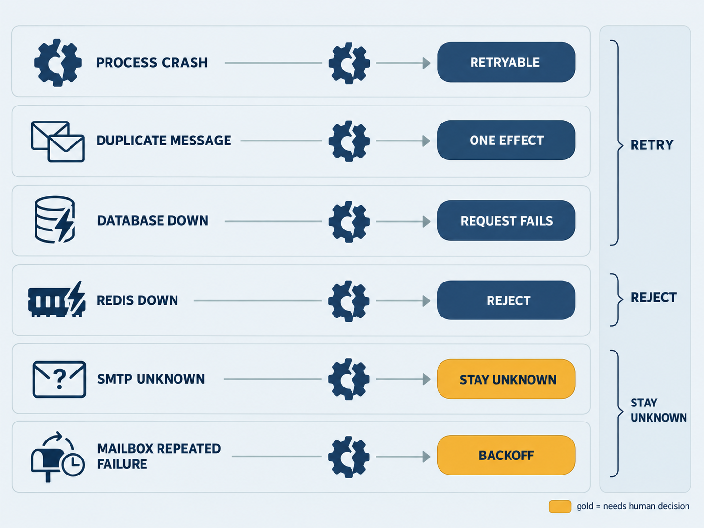

</details>

### 指标与排障

启用 `DAYLIGHT_METRICS=1` 后，用容器内脚本查看共享指标卷：

```bash
docker compose --env-file deploy/compose.env -p daylight exec -T api node scripts/metrics-report.mjs /var/lib/daylight-metrics
```

| 现象 | 优先检查 |
| --- | --- |
| 无法连接 Docker / 找不到 Compose | Docker 服务、用户权限、Compose v2；Windows 命令在 WSL 中执行 |
| 拉镜像或构建失败 | 镜像仓库、npm/apt 出网；`DEBIAN_MIRROR` 只调整 apt；先看日志，不假定设置镜像源能解决全部网络问题 |
| 端口已占用 | API 3000 与各依赖回环端口；在环境文件中改端口再启动 |
| `migrate` / `minio-init` 非 0 | 查看这两个任务日志，核对数据库/存储凭据及旧卷；应用会等待成功初始化 |
| 没有注册验证码 | 系统 SMTP 默认关闭，先创建管理员；配置系统 SMTP 并重建服务后验证 |
| 登录成功但邮箱空 | 登录账号不是收信邮箱；在设置中另加 IMAP 邮箱，确认归属与同步范围 |
| 模型/向量调用失败 | Base URL、Key、模型名、JSON/Embedding 兼容性、额度与出网；查任务和 trace |
| 检索显示关键词模式 | 查看 RAG 开关、Embedding 配置与 `embeddedCount`；配置后重建索引，检查限流记录 |
| 修改配置没有生效 | 生产环境变量需重建容器；`restart` 不会加载新环境变量；`up.sh` 不覆盖旧 env |
| 回复结果为 `unknown` | 先核对发件/收件结果，再按恢复入口处理，避免重复发送 |

更多见 [部署说明](DEPLOY.md)、[外部日历人工恢复 API](docs/calendar-recovery-api.md) 及 [验证状态](STATUS.md)。

<a id="usage"></a>
## 🧭 开始使用

1. **连接邮箱**：在设置中添加收信邮箱，填写 IMAP/TLS 与客户端授权码；需要发送时确认 SMTP 配置。QQ 示例为 `imap.qq.com:993` 与 `smtp.qq.com:465`。其他账号是否可用取决于供应商权限与网络。
2. **配置模型**：填写 OpenAI 兼容 Chat Completions 的 Base URL、Key 与模型名，要求支持 `response_format: { type: 'json_object' }`。向量检索还需可用 Embedding；没有向量时可走关键词检索，状态页应核对实际模式。
3. **同步与检索**：打开邮件页同步，查看分类摘要、提取结果及失败原因；从问答引用返回原邮件与命中段落。最近 N 封范围之外的信息不会自动获得全量扫描保证。
4. **添加工作台**：选择预置模板、绑定自己的邮箱、建立机会/事项；关联通知或粘贴外部来源，查看材料、阶段建议及行动。
5. **确认行动**：核对期限、时区、目标与冲突，采用阶段建议，确认写入待办/日历；提交、发送、对方确认分别登记。前置行动仅添加待办还不能解锁后续，需完成相应回执。
6. **使用小 D**：查询、规划或起草回复，检查收件人/正文/引用后确认发送。工作台保存草稿或登记“已发送”不会代发邮件；实际发送使用审核卡。生产日志页旧直发入口尚有迁移边界，优先使用小 D 审核流程。
7. **跟进变更**：后续补充、取消和改期保留来源及历史；新旧日程可追溯。后台任务页 `/app/jobs` 查看运行状态、允许的重试和取消，执行证据中核对耗时与费用。

模板是声明式 JSON，不执行任意代码。删除工作台保留已写入邮箱的日程/待办/招聘资料；隐藏入口也不删除数据。外部日历失败或结果未知应按恢复契约处理；对方日历、报名平台、付款或投稿系统未接入的操作不能自动判定成功。

<a id="templates"></a>
## 🧩 自己制作工作台

在「我的工作台」使用「制作模板」，或先从已有工作台导出定义再修改。个人模板可以保存不同的字段、业务阶段、通知识别规则、材料清单、页面块及允许的功能。多个工作台实例可以使用同一模板，但事项和业务数据分别保存。

1. 设定这类事情要记录什么，例如学校、岗位或主办单位。
2. 设定阶段，例如待整理、跟进中、已办完；关键阶段可要求回执。
3. 配置关键词、处理规则与材料，选择读信、待办、日历等允许的功能。
4. 用模板样例回放检查建议，再创建工作台并绑定邮箱。
5. 导出 JSON 定义供自己复用，导入后作为个人模板保存。

可直接查看并下载 [校园事务模板示例](docs/examples/campus-followup.template.json)。该文件不含用户数据，适合从「我的工作台」导入并试用。样例回放是规则预览，不会真实发信或调用付费模型。

| 模板内容 | 说明 |
| --- | --- |
| `format` / `schemaVersion` | 导入包为 `daylight-scenario-template`，当前 schema 版本为 `1` |
| `fields` / `stages` | 定义记录字段和业务阶段；字段支持 text、email、url、number、date、timezone |
| `signals` / `rules` | 声明关键词命中后的建议，以及模型分析时使用的处理规则 |
| `capabilities` / `views` | 只能从平台支持的功能和页面白名单选择，不附带可执行代码 |
| `materials` / `samples` | 材料清单与不含真实隐私的样例 |

个人模板不能通过导入包启用内置招聘/发票专用引擎，也不能绕过用户权限。导出前仍需自行检查文字和样例：结构过滤不代表自动识别所有隐私。模板字段契约以 [共享定义](shared/scenario-templates.js) 为准。

**社区方向：** 将来支持发现、分享和更新场景模板，采用版本、审核与权限控制。当前“社区”分类中的保研等模板是预置内容，尚无公开第三方模板发布市场，也不支持任意代码插件。

<a id="development"></a>
## 💻 本地开发与其他部署方式

本地开发需要 **Node.js ≥22、npm**：

```bash
npm ci
npm run dev
```

访问 `http://127.0.0.1:3000`，工作区 `/app`。开发默认 `DAYLIGHT_RUNTIME=local`；有写入的演示可设置独立 `DAYLIGHT_DATA_DIR`。本地管理员使用同一初始化脚本（密码可用前述环境变量传入），运行 `node scripts/bootstrap-admin.js --email admin@example.com --username admin`。本地模式会保存认证配置，生产模式以环境变量为准。

```bash
# 构建静态前端并使用构建产物启动
npm run build
npm start

# 独立数据目录中的测试（POSIX shell）
DAYLIGHT_DATA_DIR="$PWD/work/readme-test" npm test
```

`npm start` 中的 `--production` 选择前端构建产物；**严格生产运行模式还需 `DAYLIGHT_RUNTIME=production` 及共享依赖环境变量**。独立角色分别为 `npm run start:worker`、`npm run start:scheduler`，不会由 `npm start` 自动启动。

| 方式 | 入口 | 适用条件 |
| --- | --- | --- |
| **Compose** | `sh deploy/up.sh` | 推荐的完整单节点部署与演示；包含依赖、迁移和存储初始化 |
| **Kubernetes** | [清单与执行顺序](deploy/README.md#kubernetes-with-external-managed-dependencies) | 自备集群、受控 Secret、PG/Redis/MQ/存储和镜像仓库；迁移 Job 先于应用，集群验收仍需另做 |
| **原生 systemd** | [单元与配置](deploy/systemd/README.md) | 不使用容器的 Linux 运维方式；需自行准备相同共享依赖 |
| **已有 Windows 运行环境** | [PowerShell 启停工具](scripts/production.ps1) | 面向已有本地运行配置的专项路径，非全新机器的一键安装替代 |

### 脚本索引

| 命令 / 脚本 | 用途与前置条件 |
| --- | --- |
| `sh deploy/up.sh` / `npm run deploy:up` | 生成/复用环境文件，构建、启动并健康检查 |
| `scripts/bootstrap-admin.js` | 创建或提升管理员；至少 8 位密码；重复运行可更新密码 |
| `scripts/migrate.js` | 显式 schema 迁移与空设置初始化；Compose 自动执行 |
| `scripts/bootstrap-settings.js` | 单独初始化空设置，不读取本地邮件数据 |
| `scripts/migrate-production-data.mjs` | 已有用户/业务/附件迁移；按脚本契约先核对备份及计划 |
| `sh deploy/verify-compose.sh` | 临时项目中验证部署、健康与模块加载，结束清理自己的卷；需要 Docker、openssl、Python 3 |
| `sh deploy/verify-migrations.sh` | 独立迁移与幂等检查，使用隔离项目 |
| `scripts/verify-jobs.mjs` / `verify-production.mjs` | 专用真实 PG/MQ 下验证任务及业务提交；依赖与门控见可靠性文档 |
| `scripts/verify-concurrency.mjs` | 并发、租约、隔离、CAS 等专项检查；使用隔离依赖 |
| `scripts/verify-oss.mjs` / `verify-real-mail.mjs` | 真实存储/邮箱验证；需受控账号与授权，可能触发外部调用 |
| `scripts/verify-redis-restart.mjs` | 自建临时 Redis 并验证断连恢复，需 `redis-server` |
| `scripts/load-test.mjs` / `benchmark-jobs.mjs` | 合成任务负载，不代表真实模型业务吞吐 |
| `npm run metrics:report -- <dir>` | 从指标文件重新统计分位数与开销，目录需存在且已采集数据 |
| `node scripts/evaluate-mail.js --validate` | 零网络校验评测语料结构；`--live` 模式需配置与明确预算 |

<a id="evidence"></a>
## 📊 验证、性能与比赛交付

已有记录包括 Compose 全栈云端部署、真实 IMAP/模型/SMTP 流程、对象存储、混合检索和真实依赖下的测试。**历史通过数量只对应记录的版本与环境**，不自动代表当前未提交改动或所有外部集成。本次文档重整的检查范围见 STATUS。

成本按实际 usage 与调用时单价快照估算，报告已知累计、均价与覆盖率；缺失部分为未知，不能把部分已计价记录当作全部账单。性能矩阵使用真实 PG/MQ 和合成 handler，不能直接换算为每秒处理多少封真实邮件。用户调查占位图没有作为真实收益证据使用。

| 赛道 B 交付物 | 仓库入口 |
| --- | --- |
| 场景价值、架构、Agent、异常、验证、成本、部署七章报告 | [LaTeX 与编译说明](docs/hackathon-report/README.md) · [报告源码](docs/hackathon-report/daylight-report.tex) |
| 部署与复现 | [部署资产](deploy/README.md) · [依赖配置](DEPLOY.md) · [云端验收记录](docs/submission/deployment/README.md) |
| 架构与可靠性证据 | [架构](docs/submission/architecture.md) · [故障矩阵](docs/submission/reliability/README.md) |
| 成本性能与可观测性 | [原始测量](docs/submission/performance/README.md) · [埋点说明](docs/submission/observability/README.md) |
| PPT、实演与备用视频 | [逐页讲稿与演示脚本](docs/submission/defense.md)；最终文件/视频按发布清单补齐 |
| 最终版本与代码快照 | [提交清单](docs/submission/README.md) · [发布冻结](docs/submission/release.md) |

尚需按最终版本补齐 HTTPS、Kubernetes 多副本、跨节点 HA、备份恢复、回滚、长稳与真实用户收益验证。支持某项接口不等于所有供应商实连通过；真实飞书和外部日历验收范围分别记录。

## 📁 项目结构

```text
Daylight/
├── src/                        # 页面、组件、工作区状态与交互
├── server/
│   ├── index.js                # API / Web 入口
│   ├── worker.js               # 后台任务执行入口
│   ├── scheduler.js            # 调度入口
│   ├── jobs/                   # 持久任务、租约、outbox 与通知
│   ├── scenarios/              # 工作台、来源、材料、行动与回执
│   ├── storage/                # 共享状态与事务提交
│   ├── rag/                    # 分块、索引、检索与问答
│   └── infra/                  # PostgreSQL / Redis / MQ / OSS
├── shared/                     # 跨端模板与公共定义
├── scripts/                    # 初始化、迁移、验证与测量
├── deploy/                     # Compose、Kubernetes、systemd
├── docs/assets/readme/         # 可随仓库展示的说明图与截图占位
├── docs/submission/            # 比赛交付与验证证据
├── docs/hackathon-report/      # LaTeX 报告
├── Dockerfile
└── docker-compose.yml
```

<a id="roadmap"></a>
## 🗺️ 产品进展与后续计划

| 方向 | 当前范围 | 下一步 |
| --- | --- | --- |
| **校园与多邮箱** | 分类、混合视图、通知检索、日历和待办 | 更多真实通知样本，记录漏项、纠错与使用时间 |
| **招聘与发票** | 两个内置工作台，复用附件、模型、检索和审核功能 | 改善复杂附件、失败重试及连续往来体验 |
| **自定义工作台** | 声明式定义、个人导入导出、字段/阶段/规则 | 社区分享、模板版本管理与审核 |
| **Web / iOS / Desktop** | Web 为本仓库主客户端；iOS 已对接，Desktop 有初步版本，独立端仍在迭代 | 安装包和各端支持范围按正式发布说明提供 |
| **Android / HarmonyOS** | 后续计划 | 复用共享 API，逐步实现客户端 |
| **云端运维** | 单节点 Compose 与选定真实业务验证 | HTTPS、备份恢复、多服务器、扩容、回滚和长稳 |

路线图表达建设方向，不是交付日期或已完成验收。iOS/Desktop 独立工程和安装包不随本仓库 Docker 镜像生成；Web 可以直接部署访问。

<a id="contributing"></a>
## 🤝 参与项目

欢迎报告问题、改进部署说明、补充邮件格式用例、制作无隐私的场景模板、完善翻译与界面。开始前阅读 [贡献说明](CONTRIBUTING.md)。

- **使用问题和 Bug**：[Issues](https://github.com/why121368/Daylight/issues)。提供版本、运行方式、复现步骤、预期/实际结果和脱敏日志。
- **代码修改**：[Pull requests](https://github.com/why121368/Daylight/pulls)。说明解决的问题和验证方式；新增行为使用隔离数据测试。
- **模板与场景建议**：描述目标用户、实际流程、外部依赖和用户需要确认的操作，不附私人邮件。
- **敏感问题**：不要在公开 Issue 上传凭据或可利用细节，先通过维护者提供的私下渠道联系。

## 🛡️ 数据、许可与反馈

邮箱正文、附件和凭据只应保存在受控环境；模型分析会把相关上下文发送给所配置服务商。不要提交 `data/`、`deploy/compose.env`、私密 ICS 链接或未经授权的日志/截图。MinIO 当前 Compose 使用根凭据供单节点隔离部署，公开运营时应配置最小权限应用凭据并完成密钥与备份管理。

截图与说明图的来源/替换约定见 [素材目录](docs/assets/readme/README.md)。问题与场景建议可通过 [Issues](https://github.com/why121368/Daylight/issues) 提交。仓库当前未提供 LICENSE，使用与分发许可由维护者另行明确。

<div align="center">
  <br />
  <strong>Daylight · Turn messages into next steps.</strong>
  <p>邮件更好找，事情更好管理。</p>
</div>

## iOS 新工作台与口播

独立 iOS 工程对齐了科大学习站、邮件收发及今天/明天口播接口；原生声音选择与手机分步写信位于 iOS 工程。共享 `/api/voice-briefing` 已纳入生产接口分类，仍需既有认证和共享存储依赖。实际验证范围见 iOS 的 `docs/WEB-SYNC-2026-10-18.md`；课表与 Blackboard 专用采集会话过期，不能将接口接入视为实连验收。
